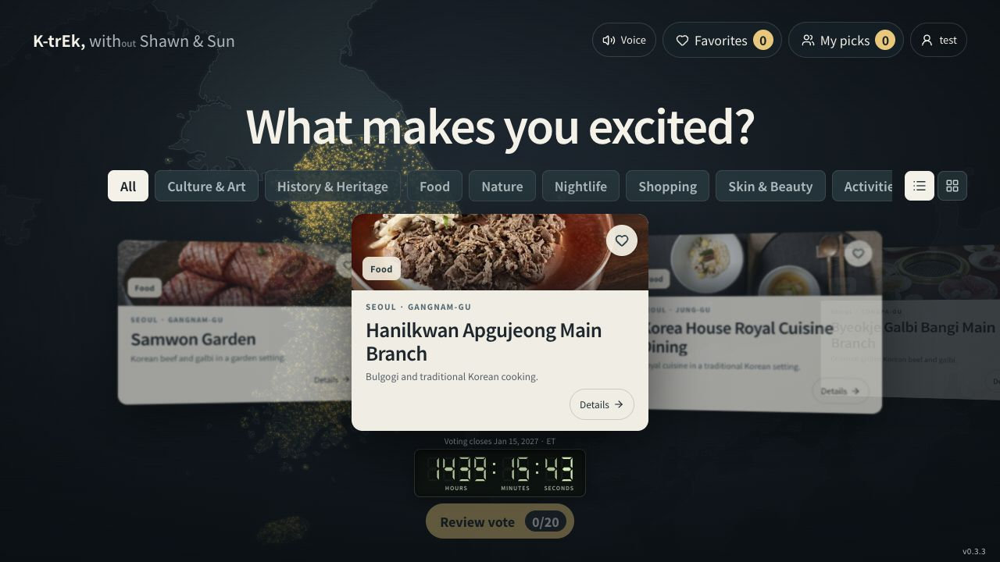
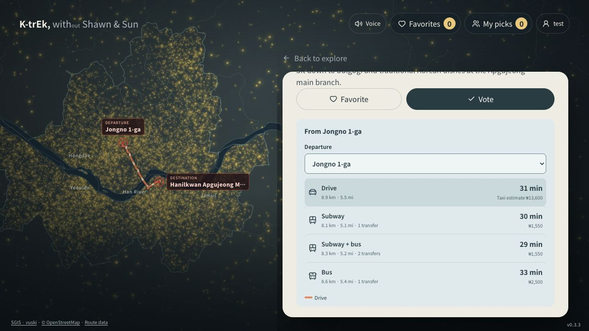
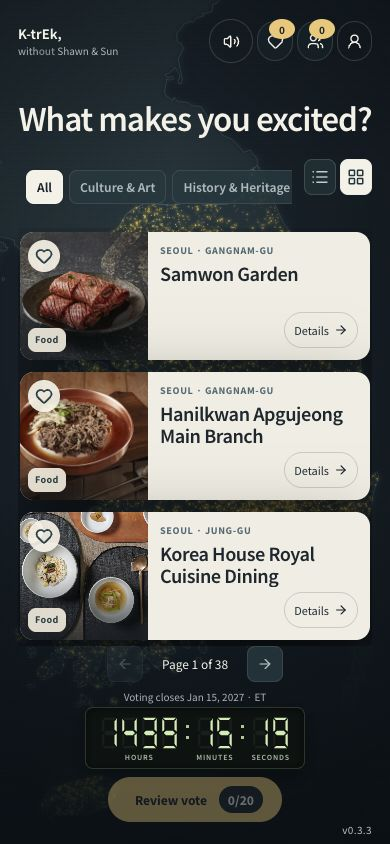

# K-trEk

**Explore Korea together — from the globe to the next place you want to visit.**

A cinematic trip planner with a continuous night-map camera, experience cards, real routes and group favorites/voting. Built with React, TypeScript, Vinext/Vite, WebGL and Cloudflare D1.

[Live site](https://shawnai.win/ktravel) · [Pull requests](https://github.com/kiseyno-AI/K-trEk/pulls) · [Development workflow](docs/GIT_WORKFLOW.md)



## What it does

- One uninterrupted globe → Korea → destination camera, with geographic outlines, city lights and route-aware labels.
- Swipeable cards or a compact paginated grid across food, history, culture, nature, activities, shopping, nightlife and skin/beauty.
- Select Seoul Station, Jongno 1-ga, Sinchon, Gangnam or Yangjae as the departure; fetch fresh driving, taxi-estimate and available bus/subway routes when it changes.
- Name/password accounts, visitor browsing, favorites and up to twenty choices submitted to D1, with a live deadline countdown.
- Host comments and ratings, a card editor, member preferences and reports backed by D1. Shawn and Sun can open Votes for activity totals and each member’s submitted choices.
- A local-only Voice/chat assistant with interaction context. Its providers require separate server-side configuration; it is not enabled on the public host.

The checked-in candidate datasets contain 114 places. A fresh local setup starts with three illustrative samples; the expanded catalogue and import tools live in [`data/`](data) and [`scripts/`](scripts). Drafts are cached per account and synchronized to D1; submitted ballots are saved in D1 only by an explicit Submit/Update vote, and confirmed by the server. Updating replaces the member’s previous ballot rather than adding duplicate votes. Browser-only submissions from older versions must be submitted again. Actual database edits and participant records are not included in this repository.

## Screenshots

### Departure selection and real routes



### Mobile



Screenshots show the local v0.3.3 implementation. The public site is released separately. Travel estimates are query-time values.

## Run locally

Use Node.js 22.13 or newer and npm. The test suite uses Node's built-in SQLite module.

```sh
git clone https://github.com/kiseyno-AI/K-trEk.git
cd K-trEk
npm ci
npm run db:setup
npm run dev
```

Open **http://localhost:3000**. `db:setup` applies local migrations and inserts missing sample IDs without replacing existing edits. Development state is stored in the ignored `.wrangler/local-state/` directory. The admin editor is available to the reserved host accounts after their initial password setup; participant and visitor flows are available from the entry screen. See [account access](docs/TRIP_AUTH.md) before running a shared instance.

Kakao directions need a **server-side REST key**. Set `KAKAO_MOBILITY_REST_API_KEY` in an ignored `.dev.vars` file, using [`.env.example`](.env.example) as the variable reference. The page still loads without the key; route requests report that directions are not configured. See [Kakao setup](docs/KAKAO_DIRECTIONS.md) and [departure selection](docs/DEPARTURE_SELECTION_0_3_3.md). Optional assistant provider settings are documented in [TRIP_ASSISTANT.md](docs/TRIP_ASSISTANT.md).

## Checks

```sh
npm run lint
npx tsc --noEmit
npm test
npm run ui:check
git diff --check
```

The current suite passes 302 tests locally. PRs run these checks in GitHub Actions; they do not deploy the site. Read [AGENTS.md](AGENTS.md) before making changes, and keep development on feature branches.

## Project map

```text
app/           Explorer, globe, account/admin UI and API routes
lib/           Activity model, routes, camera, auth and assistant logic
data/          Candidate catalogue, coordinates and photo provenance
db/            D1 schema migrations and local binding configuration
public/trip/   Map geometry, lights, textures, fonts and card photographs
tests/         Behavior, persistence, camera and interaction regressions
docs/          Setup, design decisions and verification evidence
```

## Data and media

Place descriptions and booking conditions retain their source and verification status. Unknown ratings, booking availability and travel-date driving times are not fabricated. Clinic information is not a medical recommendation.

Photo and geographic assets have their own provenance. Some photographs are official-site references with **unverified reuse rights**; local copies do not grant a redistribution license. Preserve credits and check the individual records before reuse. See [photo sources](docs/ACTIVITY_PHOTOS.md), [food photos](docs/FOOD_MENU_PHOTOS_2026_11.md), [Seoul geography](docs/SEOUL_GEOGRAPHY.md) and the manifests under `data/`. No blanket open-source license is asserted for third-party media.

## Releases

Source control, PR merge and public deployment are separate steps. This repository has no automatic deployment workflow. In the current hosting arrangement, a public Worker serves an existing build through the Shawn AI Lab proxy. Follow [PUBLIC_DEPLOYMENT.md](docs/PUBLIC_DEPLOYMENT.md) only when a release is explicitly requested; rebuilding the live checkout can replace assets used by the running website.
